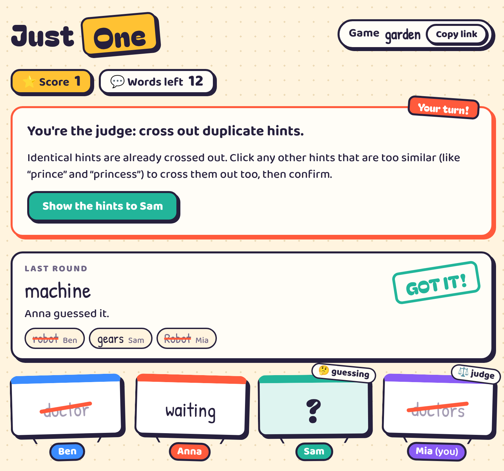
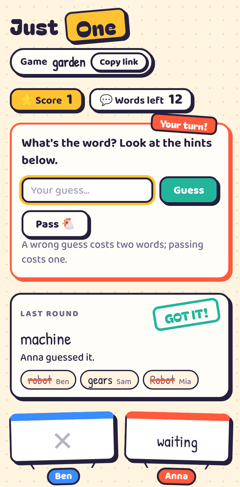

Just One
========

A web version of the board game [Just One](https://www.boardgamegeek.com/boardgame/254640/just-one). If you like this (unaffiliated) digital version, support the original designers by buying their game.

Playing
-------

  

Give a one-word hint to help a teammate guess the secret word, but identical hints cancel out!
One player starts a game and shares the link, the others join with a name and a password.
Everyone plays on their own phone or computer, in the same room or on a video call. It's free and
there is nothing to install or sign up for. If your phone locks or the connection drops, the game
reconnects you automatically.

Screenshots
-----------

Word lists
----------
The game comes with its own word lists, picked for this game: more than 4,600 words in six languages,
so you can play many games before a word comes back. Words never repeat within a game.

| Language  | Words |
|-----------|------:|
| German    | 1,226 |
| English   | 1,139 |
| French    |   799 |
| Dutch     |   558 |
| Hungarian |   544 |
| Italian   |   368 |

When you start a game, you choose the language and how many words to play (13 by default).

Want to play in another language, or with your own words? A word list is a plain text file with one
word per line in `include/words_*.txt`. To add one, add the file, a variant to `WordList` in
`src/game.rs`, and an option to the word list menu in `public/index.html`. New lists are very welcome
as pull requests!

Hosting
-------
There are two ways to host the game. Both serve the same page and play the same game.

### With Docker (or any server)

The self-hosted server is a single binary with the page built in:

    docker build -t justone .
    docker run -p 3030:3030 justone

and open http://localhost:3030. Without Docker, run `cargo run --release` instead. Set the `PORT` and
`HOST` environment variables to change where it listens (default `0.0.0.0:3030`). For HTTPS, put it
behind a reverse proxy such as Caddy or nginx (with WebSocket support for `/chat`). Games are kept in
memory, so they are lost when the server restarts.

### On Cloudflare Workers (free)

The game also runs as a [Cloudflare Worker](https://developers.cloudflare.com/workers/) and fits in the
free plan. The page in `public/` is served as static assets, and each game is a Durable Object that holds
the players' WebSockets and stores the game state, so games survive restarts.

Requirements: Rust with the `wasm32-unknown-unknown` target (`rustup target add wasm32-unknown-unknown`)
and Node.js.

    npx wrangler dev      # run locally on http://localhost:8787
    npx wrangler deploy   # deploy to your Cloudflare account

In both cases, games are removed when they finish or after 90 minutes without activity.

Development
-----------
- `src/game.rs`: the game rules, as a state machine without any I/O (test with `cargo test`)
- `src/room.rs`: the WebSocket protocol of a game room, shared by both servers
- `src/native_server.rs`: the self-hosted server
- `src/worker_app.rs`: the Cloudflare Worker and Durable Object
- `public/index.html`: the whole web page

Any suggestions, word lists, and patches are welcome!
